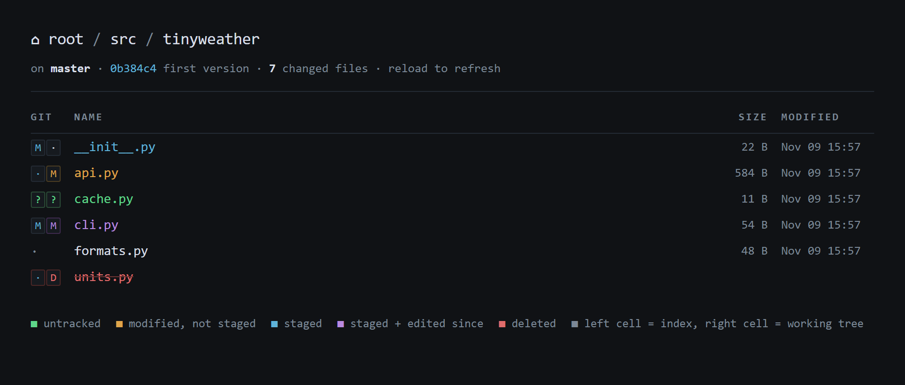
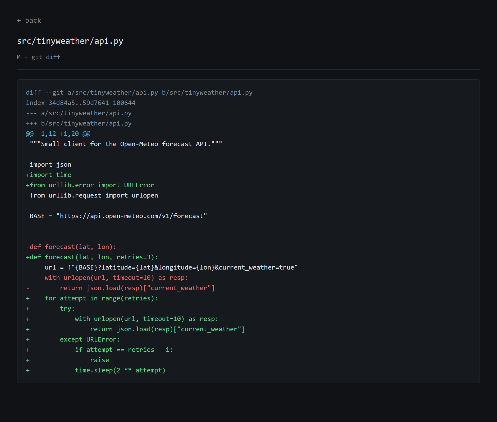

# gitls

[](https://github.com/abdonader500/gitls/actions/workflows/tests.yml)

Browse a folder in your browser with every file colored by its `git status`, and click any change to see its diff.

One Python file, standard library only, nothing to install.



## Why

`git status` prints a flat list. When a change spreads across many folders it is hard to see where the edits sit in the tree, which folders are untouched, and what a deleted file used to sit next to. `gitls` draws the folder you already know and marks it up with the same information.

## Usage

```sh
python gitls.py                    # serve the current folder and open the browser
python gitls.py path/to/repo       # serve another folder
python gitls.py -p 9000 --no-open  # pick the port, don't launch a browser
```

Then open <http://localhost:8777/>. Reload the page to refresh; nothing is cached.

Needs Python 3.10+ and `git` on your `PATH`. Works on Linux, macOS and Windows.

## Reading the badges

Each changed file gets a two-cell badge taken straight from `git status --porcelain`. The left cell is the index (what is staged), the right cell is the working tree.

| Badge | Color | Meaning |
|---|---|---|
| `? ?` | green | untracked |
| `· M` | amber | modified, not staged |
| `M ·` | blue | staged |
| `M M` | purple | staged, then edited again |
| `· D` | red, struck through | deleted, still listed so you can see what is gone |
| `U U` | pink | merge conflict |

Folders show how many changed files they contain. Click a badge to open that file's diff; untracked files show their full contents.



## How it works

- One `git status --porcelain=v1 -z --untracked-files=all` call per page. The NUL-separated format keeps names with spaces, quotes or non-ASCII characters intact, and carries both paths of a rename.
- Files git still tracks but that are gone from disk are added back into the listing as rows of their own.
- The diff view joins `git diff` and `git diff --cached`, so a file that is staged *and* edited again shows both halves.
- It only reads. It never stages, commits or writes to the repository.

## Security

The server listens on `127.0.0.1` only, and it refuses any request whose `Host` header is not `localhost`, `127.0.0.1` or `[::1]`. The second check blocks DNS rebinding, where a web page you visit points its own domain at `127.0.0.1` to read local servers through your browser.

## Tests

```sh
python -m unittest -v
```

The suite builds a scratch repository with a file in every state (including a non-ASCII name, a rename and a deletion), then checks the parsed statuses, the rendered listing, both diff views and the host check. CI runs it on Linux, macOS and Windows.

## License

[MIT](LICENSE)
